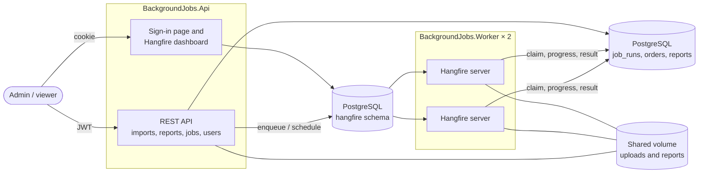
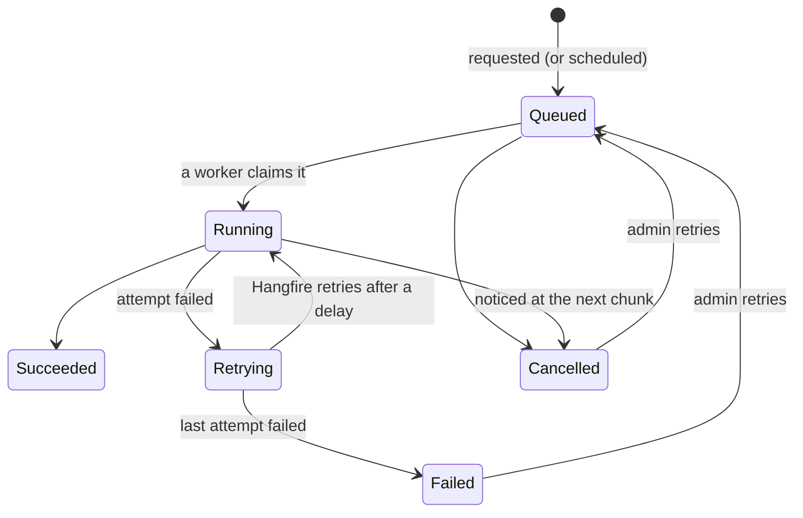

# Background Jobs

**English** · [Türkçe](README.tr.md)

The background work of a small shop's back office — large order imports, sales reports on a schedule and housekeeping — run by Hangfire workers on PostgreSQL. Jobs survive restarts, retry with back-off, never run twice, can be cancelled, and every step is visible and audited.

[](https://github.com/Beratoguzhan620/background-jobs/actions/workflows/ci.yml)


## Try it

```bash
docker compose up --build
```

This starts PostgreSQL, the API and **two worker processes**. Then:

- API reference: http://localhost:8080/scalar — sign in with `POST /api/auth/login` as `admin@example.com` / `admin-password-local` (local defaults; change them in `.env`).
- Dashboard: http://localhost:8080/hangfire — the same admin account.
- A sample order file to upload is in [`docs/sample-orders.csv`](docs/sample-orders.csv).

## Features

- **Accounts and roles:** admins start, cancel and retry jobs, manage users and open the dashboard; viewers follow status and results. The first admin comes from configuration. The API uses JWT, the dashboard a cookie sign-in; both come from the same accounts.
- **Order imports:**
  - Upload a CSV of up to 50 MB; it is saved while being hashed, and a wrong header is refused at once.
  - A worker reads it in chunks of 500 rows with progress, and inserts the valid rows.
  - Rejected rows go to a downloadable file with the line number and the reason.
  - The same file twice is refused; orders already imported by another file are counted as duplicates, not inserted again.
- **Reports:** sales per day and the top SKUs for a period, now or at a chosen time (CSV and a JSON summary). A nightly report covers the previous day.
- **Housekeeping:** an hourly job deletes uploads past their retention period and rescues runs that were saved but never handed to Hangfire.
- **Failures:** automatic retries with growing delays (15 s, 1 min, 5 min by default); a failed or cancelled run can be retried by an admin.
- **Cancellation:** queued, scheduled or running runs can be cancelled; a running import stops at its next chunk.
- **Monitoring:** job runs with status, progress, attempts and results; statistics (runs by status, queue lengths, connected workers); health checks for the API and each worker; the Hangfire dashboard.
- **Audit trail:** sign-ins (failed ones too), new users, imports, reports, cancellations, retries, and actions taken in the dashboard, each with the person who did it.

## Screenshots

| Sign-in | Dashboard |
|---|---|
|  |  |
| **Recurring jobs** | **Two workers connected** |
|  |  |
| **Finished jobs** | **API reference** |
|  |  |

## Tech stack

- ASP.NET Core 10 minimal APIs, ProblemDetails, OpenAPI with Scalar
- Hangfire 1.8 with PostgreSQL storage, separate queues for imports, reports and maintenance
- Entity Framework Core 10 with PostgreSQL (Npgsql), migrations, `unnest` bulk inserts
- JWT for the API, cookie sign-in for the dashboard, antiforgery on forms
- Serilog with correlation ids and masked personal data
- xUnit, Testcontainers (real PostgreSQL), in-process Hangfire servers, Playwright for the dashboard flow
- GitHub Actions: warnings as errors, tests, pending-migration check, Compose smoke test with two workers, browser flow
- Docker / Docker Compose

## Architecture



How a run moves through its states:



## Design decisions

- **API and workers are separate processes.** The API only writes jobs to storage. Workers can be scaled, restarted or deployed without touching it; Compose runs two of them to prove the point.
- **Our own `job_runs` next to Hangfire's tables.** Hangfire knows queues and retries; people need progress, results, who asked and a stable id. The run links to its Hangfire job by id.
- **A run is claimed before any work.** One conditional `UPDATE` moves it from `Queued` or `Retrying` to `Running`. Hangfire delivers at least once, so a second delivery (another worker, or a retry racing a slow first attempt) claims nothing and stops. A heartbeat lets a run left behind by a crashed worker be claimed again, and a worker that shuts down hands its run back immediately.
- **The database refuses duplicates.** A partial unique index on the dedup key covers queued, running and finished runs, so two identical uploads at the same moment cannot both get in, while a failed run can be tried again. The nightly report uses the date as its key, so a schedule that fires twice still makes one report.
- **Imports are safe to repeat.** Rows go in with `INSERT … SELECT FROM unnest(...) ON CONFLICT (order_no) DO NOTHING`, 500 at a time, and the final counts come from the database. A retry after a half-finished attempt neither duplicates orders nor miscounts them.
- **Cancellation is cooperative.** Cancelling marks the run; the job notices at its next progress update and stops cleanly instead of being killed mid-write. An `xmin` concurrency token stops an admin's cancel from silently overwriting a worker's update.
- **The Hangfire job id is stored without a concurrency check.** A worker can claim a run in the moment between enqueueing it and saving the id, so the id is written with a single `UPDATE` of that column only.
- **Orphans are rescued.** If the API stops after saving a run but before enqueueing it, the hourly job finds runs without a Hangfire id and enqueues them.
- **People sign in as themselves.** The dashboard can delete and requeue jobs, so it sits behind a cookie sign-in for admins, with its actions in the audit trail. Viewers keep read access through the API. In a real deployment the dashboard would also stay on the internal network or behind single sign-on.

## Commands

| Command | What it does |
|---|---|
| `docker compose up --build` | PostgreSQL, the API on http://localhost:8080 and two workers |
| `docker compose up --build --scale worker=4` | The same with four workers |
| `dotnet test` | Unit and integration tests (Docker needed for Testcontainers) |
| `dotnet run --project src/BackgroundJobs.Api` | Run the API locally (configuration below) |
| `dotnet run --project src/BackgroundJobs.Worker` | Run a worker locally |
| `node tests/e2e/dashboard.mjs` | Browser flow against a running stack (needs `npm i playwright`) |
| `dotnet ef migrations add <Name> --project src/BackgroundJobs.Infrastructure --startup-project src/BackgroundJobs.Api --output-dir Persistence/Migrations` | Add a migration |

Configuration for a local run, kept out of the repository:

```bash
dotnet user-secrets --project src/BackgroundJobs.Api set "ConnectionStrings:Jobs" "Host=localhost;Database=background_jobs;Username=…;Password=…"
dotnet user-secrets --project src/BackgroundJobs.Api set "Jwt:SigningKey" "<at least 32 characters>"
dotnet user-secrets --project src/BackgroundJobs.Api set "Bootstrap:AdminEmail" "you@example.com"
dotnet user-secrets --project src/BackgroundJobs.Api set "Bootstrap:AdminPassword" "<at least 12 characters>"
```

The worker needs `ConnectionStrings:Jobs` too; both read `Storage:Root` for the shared file folder.

## Tests

69 tests: 19 unit tests and 50 integration tests that run the real API and Hangfire servers against PostgreSQL in Testcontainers, plus a browser flow in CI.

- **Run once:** a run delivered to two workers at the same moment is done once; two Hangfire servers share the queue and every run has one attempt; the nightly report fired three times at once makes one report.
- **Imports:** valid files, rejected rows with line numbers and reasons, the same file twice, overlapping orders across files, unusable files, a 20,000-row file.
- **Failures:** a job that keeps failing is retried twice, marked failed, then succeeds when an admin retries it; housekeeping deletes old uploads and rescues an orphaned run.
- **Reports:** totals per day in Türkiye time, the top SKU, scheduling and cancelling, impossible periods.
- **Access:** roles on every endpoint, tampered tokens, the dashboard behind sign-in, viewers kept out of it, antiforgery, return addresses that try to leave the site, and the API refusing the dashboard cookie.
- **Browser flow (Playwright):** sign-in page, wrong password, the dashboard, an import finished by a worker, both workers connected, triggering a recurring job and finding it in the audit trail.

## Roadmap and known gaps

- Email the finished reports through the [notification-service](https://github.com/Beratoguzhan620/notification-service).
- Purge [Mini Banking API](https://github.com/Beratoguzhan620/mini-banking-api) idempotency keys as a recurring job.
- Upload straight to object storage (S3-compatible) instead of a shared volume.
- The dashboard keeps Hangfire's own look; only the sign-in page follows the portfolio design.

## License

[MIT](LICENSE) · Berat Oğuzhan Turğut · [GitHub](https://github.com/Beratoguzhan620)
