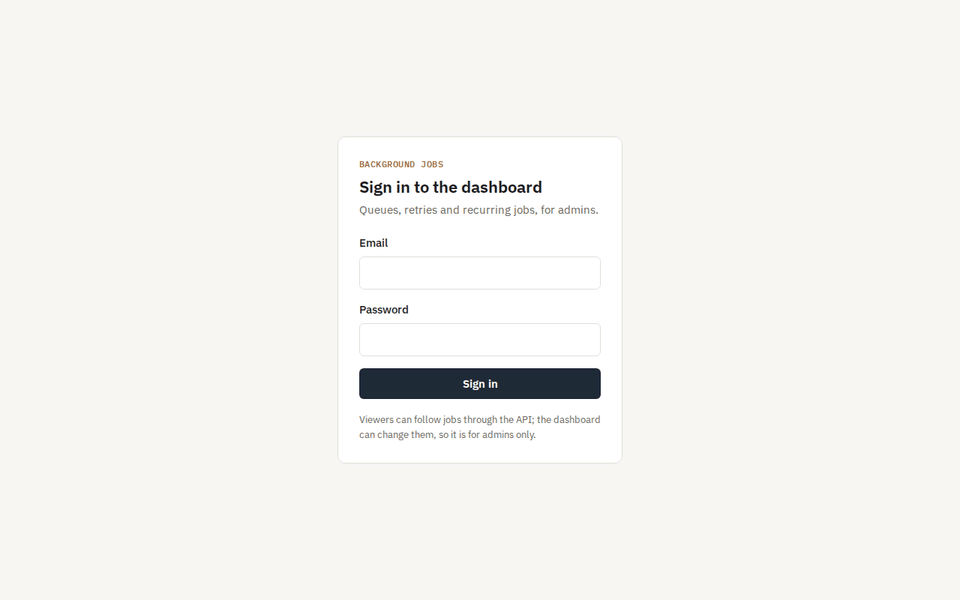
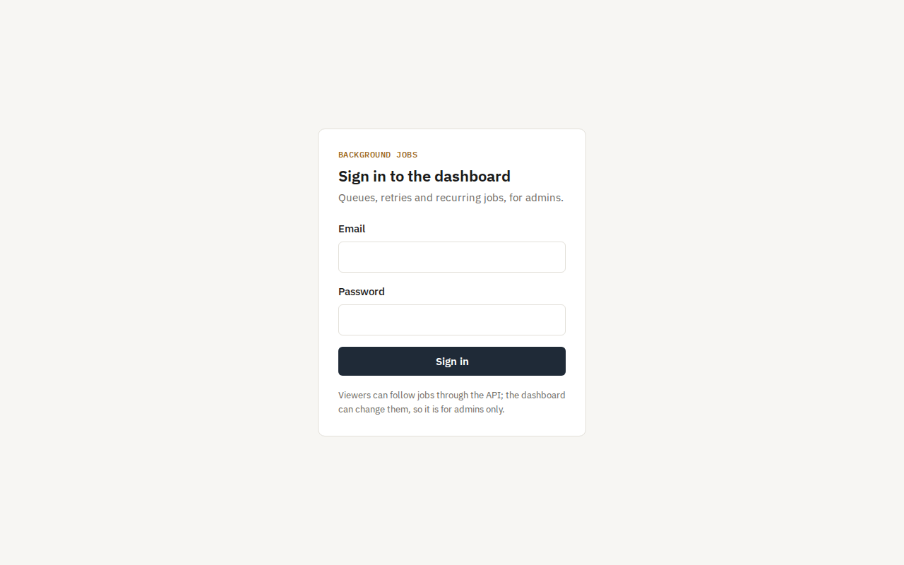
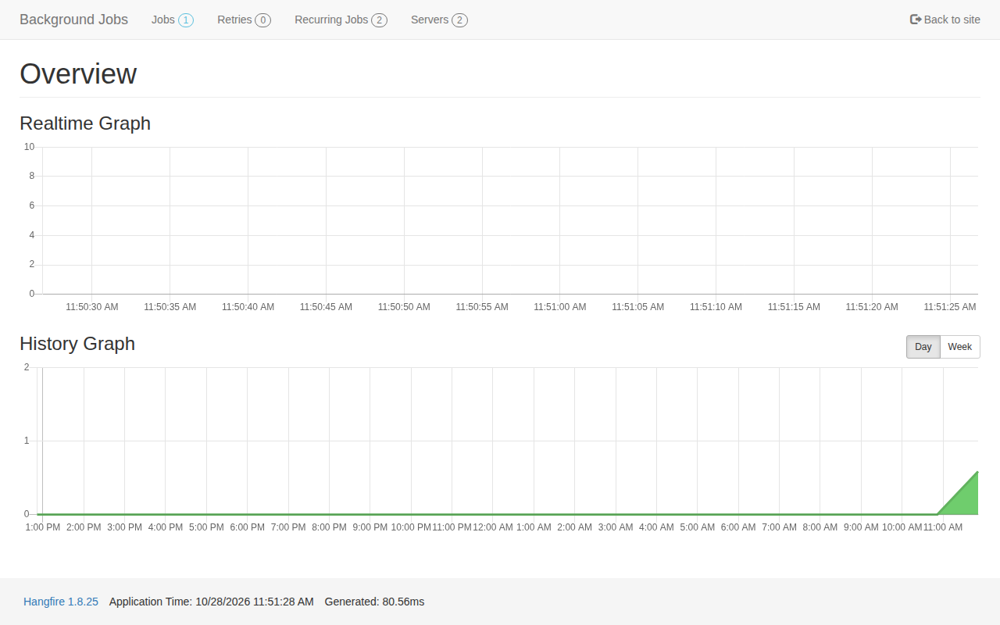
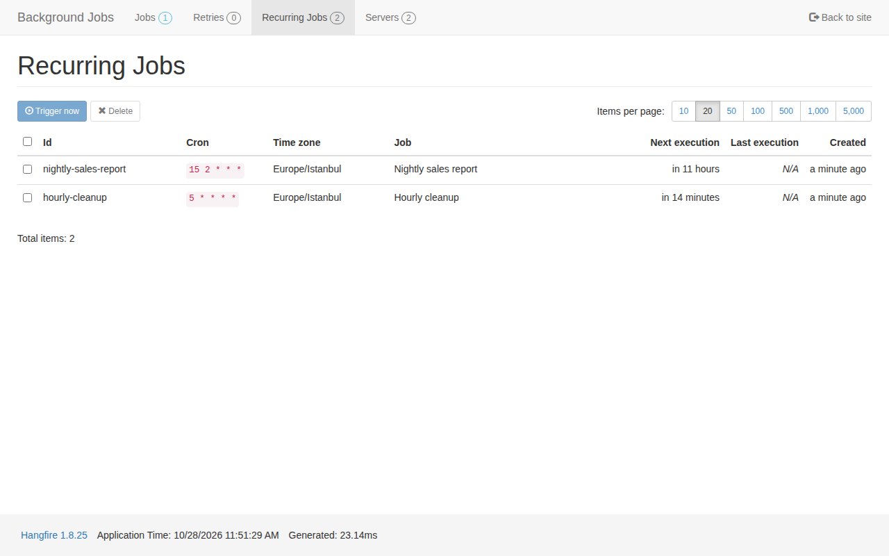
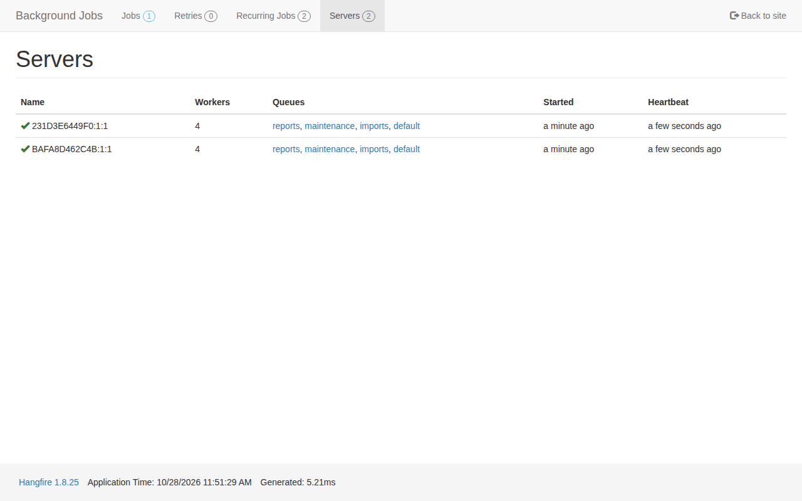
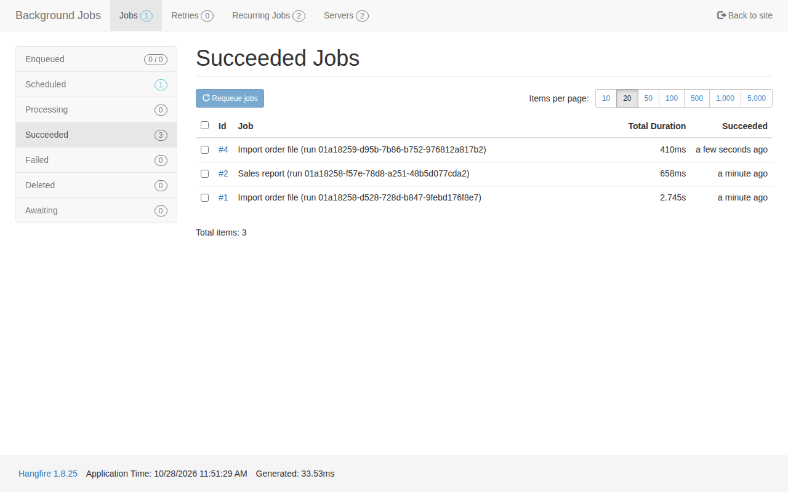
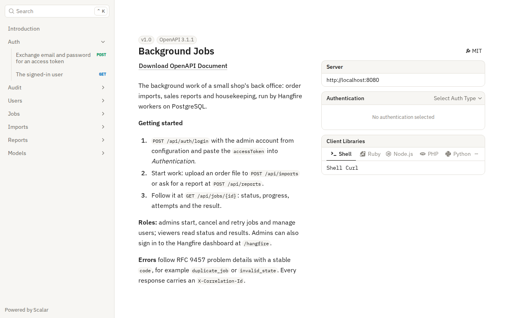
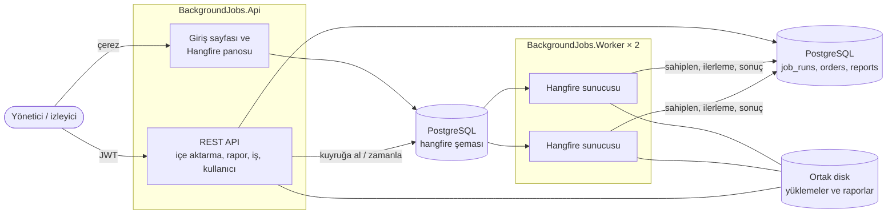
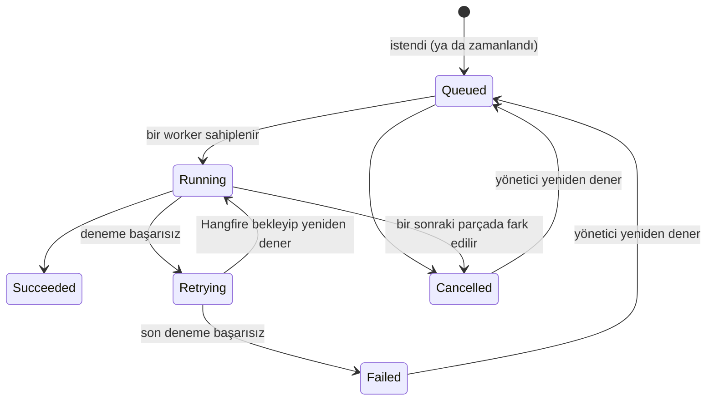

# Background Jobs

[English](README.md) · **Türkçe**

Küçük bir mağazanın arka ofisindeki arka plan işleri (büyük sipariş dosyalarının içe aktarılması, zamanlanmış satış raporları ve temizlik), PostgreSQL üzerinde Hangfire worker'larıyla çalışıyor. İşler yeniden başlatmalara dayanıyor, artan aralıklarla yeniden deneniyor, asla iki kez çalışmıyor, iptal edilebiliyor ve her adımı görünür ve kayıt altında.

[](https://github.com/Beratoguzhan620/background-jobs/actions/workflows/ci.yml)




## Deneme

```bash
docker compose up --build
```

Bu komut PostgreSQL'i, API'yi ve **iki worker sürecini** başlatır. Sonra:

- API belgesi: http://localhost:8080/scalar. `POST /api/auth/login` ile `admin@example.com` / `admin-password-local` hesabıyla giriş yap (yerel varsayılanlar; `.env` dosyasından değiştirebilirsin).
- Pano: http://localhost:8080/hangfire, aynı yönetici hesabıyla.
- Yüklemek için örnek bir sipariş dosyası: [`docs/sample-orders.csv`](docs/sample-orders.csv).

## Özellikler

- **Hesaplar ve roller:** yöneticiler iş başlatır, iptal eder, yeniden dener, kullanıcıları yönetir ve panoyu açar; izleyiciler durum ve sonuçları takip eder. İlk yönetici yapılandırmadan gelir. API JWT, pano çerezli giriş kullanır; ikisi de aynı hesaplardan beslenir.
- **Sipariş içe aktarma:**
  - En fazla 50 MB'lık CSV yüklenir; dosya kaydedilirken özeti (hash) hesaplanır, başlık satırı yanlışsa hemen reddedilir.
  - Bir worker dosyayı 500 satırlık parçalar halinde, ilerlemesini kaydederek okur ve geçerli satırları ekler.
  - Reddedilen satırlar satır numarası ve nedeniyle birlikte indirilebilir bir dosyaya yazılır.
  - Aynı dosya ikinci kez kabul edilmez; başka bir dosyayla zaten gelmiş siparişler yeniden eklenmez, mükerrer olarak sayılır.
- **Raporlar:** bir dönem için günlük satışlar ve en çok satan SKU'lar, hemen ya da seçilen bir zamanda (CSV ve JSON özet). Gece raporu bir önceki günü kapsar.
- **Temizlik:** saatlik bir iş, saklama süresi dolan yüklemeleri siler ve kaydedilip Hangfire'a hiç verilmemiş işleri kurtarır.
- **Hatalar:** artan aralıklarla otomatik yeniden deneme (varsayılan 15 sn, 1 dk, 5 dk); başarısız ya da iptal edilmiş bir işi yönetici yeniden başlatabilir.
- **İptal:** kuyrukta bekleyen, zamanlanmış ya da çalışan işler iptal edilebilir; çalışan bir içe aktarma bir sonraki parçada durur.
- **İzleme:** durumu, ilerlemesi, deneme sayısı ve sonucuyla iş kayıtları; istatistikler (duruma göre işler, kuyruk uzunlukları, bağlı worker'lar); API ve her worker için sağlık kontrolleri; Hangfire panosu.
- **Denetim kaydı:** girişler (başarısızlar dahil), yeni kullanıcılar, içe aktarmalar, raporlar, iptaller, yeniden denemeler ve panodan yapılan işlemler; her biri işlemi yapan kişiyle birlikte.

## Ekran görüntüleri

| Giriş | Pano |
|---|---|
|  |  |
| **Periyodik işler** | **Bağlı iki worker** |
|  |  |
| **Biten işler** | **API belgesi** |
|  |  |

## Teknolojiler

- ASP.NET Core 10 minimal API, ProblemDetails, Scalar ile OpenAPI
- Hangfire 1.8 ve PostgreSQL deposu; içe aktarma, rapor ve bakım için ayrı kuyruklar
- Entity Framework Core 10 ve PostgreSQL (Npgsql), migration'lar, `unnest` ile toplu ekleme
- API için JWT, pano için çerezli giriş, formlarda antiforgery
- Serilog ile correlation id ve maskelenmiş kişisel veri
- xUnit, Testcontainers (gerçek PostgreSQL), aynı süreçte çalışan Hangfire sunucuları, pano akışı için Playwright
- GitHub Actions: uyarılar hata sayılır, testler, bekleyen migration kontrolü, iki worker'lı Compose duman testi, tarayıcı akışı
- Docker / Docker Compose

## Mimari



Bir işin durumları:



## Tasarım kararları

- **API ve worker'lar ayrı süreçler.** API işleri yalnızca depoya yazar. Worker'lar API'ye dokunmadan çoğaltılabilir, yeniden başlatılabilir ya da yeniden dağıtılabilir; Compose bunu göstermek için iki tane çalıştırır.
- **Hangfire tablolarının yanında kendi `job_runs` tablomuz.** Hangfire kuyrukları ve yeniden denemeleri bilir; insanların ise ilerlemeye, sonuca, işi kimin istediğine ve kalıcı bir id'ye ihtiyacı var. İş kaydı, Hangfire işine id'siyle bağlanır.
- **Bir iş, çalışmaya başlamadan önce sahiplenilir.** Tek bir koşullu `UPDATE`, işi `Queued` ya da `Retrying` durumundan `Running` durumuna geçirir. Hangfire bir işi en az bir kez teslim eder; ikinci teslimat (başka bir worker ya da yavaş ilk denemeyle yarışan bir yeniden deneme) sahiplenecek bir şey bulamaz ve durur. Heartbeat sayesinde çöken bir worker'ın bıraktığı iş yeniden sahiplenilebilir; kapanan bir worker ise işini hemen geri bırakır.
- **Mükerrerleri veritabanı reddeder.** Dedup anahtarı üzerindeki kısmi unique indeks bekleyen, çalışan ve bitmiş işleri kapsar. Böylece aynı anda gelen iki özdeş yüklemenin ikisi birden giremez; başarısız bir iş ise yeniden denenebilir. Gece raporunun anahtarı tarihtir; zamanlayıcı iki kez tetiklense bile tek rapor çıkar.
- **İçe aktarma tekrar edilebilir.** Satırlar 500'erli gruplar halinde `INSERT … SELECT FROM unnest(...) ON CONFLICT (order_no) DO NOTHING` ile eklenir ve son sayılar veritabanından alınır. Yarıda kalmış bir denemeden sonraki yeniden deneme ne sipariş çoğaltır ne de yanlış sayar.
- **İptal, işin iş birliğiyle yapılır.** İptal işi işaretler; iş bunu bir sonraki ilerleme güncellemesinde fark eder ve yazmanın ortasında öldürülmek yerine temiz bir şekilde durur. `xmin` eşzamanlılık belirteci, yöneticinin iptalinin worker'ın güncellemesini sessizce ezmesini engeller.
- **Hangfire iş id'si eşzamanlılık kontrolü olmadan kaydedilir.** Bir worker, iş kuyruğa alındığı an ile id'nin kaydedildiği an arasında işi sahiplenebilir. Bu yüzden id, yalnızca o sütunu değiştiren tek bir `UPDATE` ile yazılır.
- **Sahipsiz işler kurtarılır.** API bir işi kaydettikten sonra ama kuyruğa almadan önce durursa, saatlik iş Hangfire id'si olmayan işleri bulup kuyruğa alır.
- **Herkes kendi hesabıyla girer.** Pano iş silip yeniden kuyruğa alabildiği için yöneticilere özel çerezli girişin arkasında durur ve buradaki işlemler denetim kaydına yazılır. İzleyiciler API üzerinden okuma erişimini korur. Gerçek bir kurulumda pano ayrıca iç ağda ya da tek oturum açma (SSO) arkasında kalmalı.

## Komutlar

| Komut | Ne yapar |
|---|---|
| `docker compose up --build` | PostgreSQL, http://localhost:8080 üzerinde API ve iki worker |
| `docker compose up --build --scale worker=4` | Aynısı, dört worker ile |
| `dotnet test` | Birim ve entegrasyon testleri (Testcontainers için Docker gerekir) |
| `dotnet run --project src/BackgroundJobs.Api` | API'yi yerelde çalıştırır (aşağıdaki ayarlarla) |
| `dotnet run --project src/BackgroundJobs.Worker` | Yerelde bir worker çalıştırır |
| `node tests/e2e/dashboard.mjs` | Çalışan bir kuruluma karşı tarayıcı akışı (`npm i playwright` gerekir) |
| `dotnet ef migrations add <Ad> --project src/BackgroundJobs.Infrastructure --startup-project src/BackgroundJobs.Api --output-dir Persistence/Migrations` | Migration ekler |

Yerelde çalıştırmak için ayarlar; repoya girmezler:

```bash
dotnet user-secrets --project src/BackgroundJobs.Api set "ConnectionStrings:Jobs" "Host=localhost;Database=background_jobs;Username=…;Password=…"
dotnet user-secrets --project src/BackgroundJobs.Api set "Jwt:SigningKey" "<en az 32 karakter>"
dotnet user-secrets --project src/BackgroundJobs.Api set "Bootstrap:AdminEmail" "sen@example.com"
dotnet user-secrets --project src/BackgroundJobs.Api set "Bootstrap:AdminPassword" "<en az 12 karakter>"
```

Worker da `ConnectionStrings:Jobs` ister; ikisi de ortak dosya klasörü için `Storage:Root` ayarını okur.

## Testler

69 test: 19 birim testi ve gerçek API ile Hangfire sunucularını Testcontainers'taki PostgreSQL'e karşı çalıştıran 50 entegrasyon testi. Bunlara ek olarak CI'da bir tarayıcı akışı çalışır.

- **Tek kez çalışma:** aynı anda iki worker'a teslim edilen bir iş bir kez yapılır; iki Hangfire sunucusu kuyruğu paylaşır ve her işin tek denemesi olur; aynı anda üç kez tetiklenen gece raporu tek rapor çıkarır.
- **İçe aktarma:** geçerli dosyalar, satır numarası ve nedeniyle reddedilen satırlar, aynı dosyanın ikinci kez gelmesi, dosyalar arasında çakışan siparişler, kullanılamaz dosyalar, 20.000 satırlık bir dosya.
- **Hatalar:** sürekli hata veren bir iş iki kez yeniden denenir, başarısız olarak işaretlenir, sonra yönetici yeniden denediğinde başarılı olur; temizlik işi eski yüklemeleri siler ve sahipsiz bir işi kurtarır.
- **Raporlar:** Türkiye saatine göre günlük toplamlar, en çok satan SKU, zamanlama ve iptal, imkânsız dönemler.
- **Erişim:** her uç noktada roller, değiştirilmiş token'lar, giriş arkasındaki pano, panoya giremeyen izleyiciler, antiforgery, siteden çıkmaya çalışan dönüş adresleri ve API'nin pano çerezini kabul etmemesi.
- **Tarayıcı akışı (Playwright):** giriş sayfası, yanlış parola, pano, bir worker'ın bitirdiği içe aktarma, bağlı iki worker, panodan periyodik bir işi tetikleyip bunu denetim kaydında bulma.

## Yol haritası ve bilinen eksikler

- Biten raporların [notification-service](https://github.com/Beratoguzhan620/notification-service) üzerinden e-postayla gönderilmesi.
- [Mini Banking API](https://github.com/Beratoguzhan620/mini-banking-api) idempotency anahtarlarının periyodik bir işle temizlenmesi.
- Ortak disk yerine doğrudan nesne depolamaya (S3 uyumlu) yükleme.
- Pano Hangfire'ın kendi görünümünde; portföy tasarımına yalnızca giriş sayfası uyuyor.

## Lisans

[MIT](LICENSE) · Berat Oğuzhan Turğut · [GitHub](https://github.com/Beratoguzhan620)
